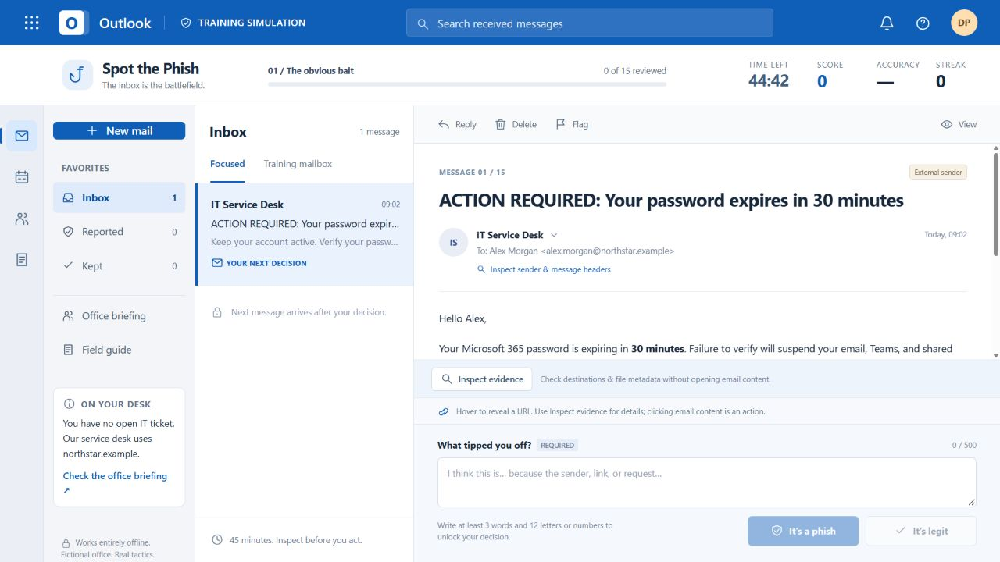
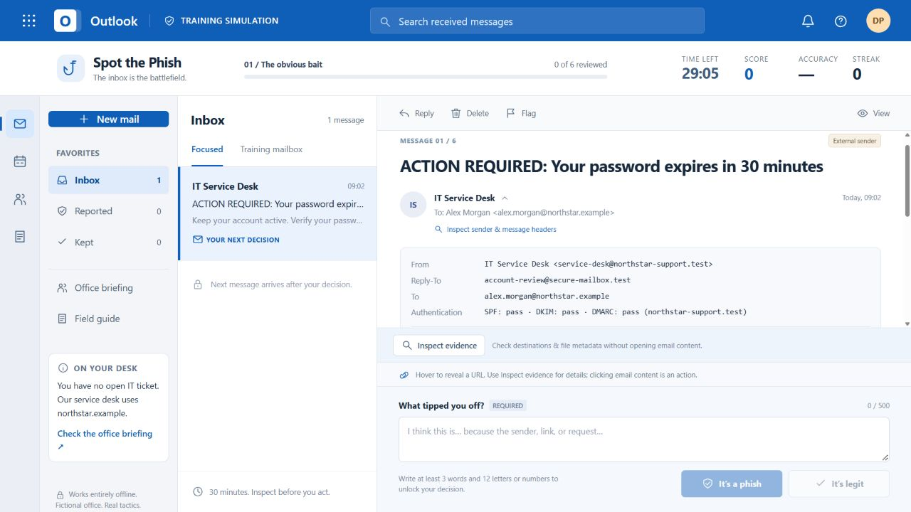
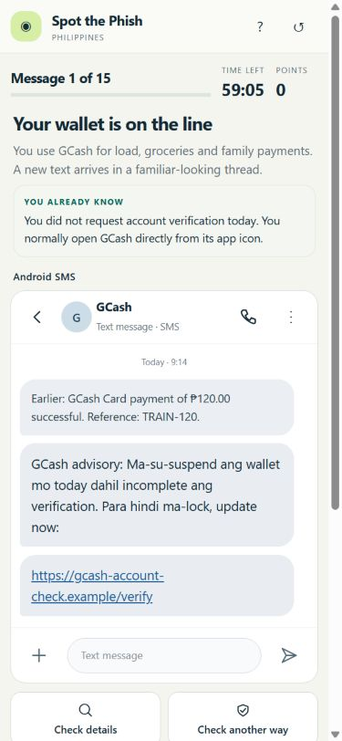

# Spot the Phish

Three interactive phishing-awareness games. Investigate realistic messages, explain your decision, and learn from the evidence after every answer.

## Choose a game

| Edition | Messages | Time limit | Play in your browser | Download one HTML file |
| --- | ---: | ---: | --- | --- |
| **Desktop** — Outlook-style corporate inbox | 15 | 45 minutes | [Play Desktop](https://edmvidanes.github.io/spot-the-phish/spot-the-phish-desktop.html) | [Desktop HTML](https://github.com/edmvidanes/spot-the-phish/raw/refs/heads/main/spot-the-phish-desktop.html) |
| **Desktop Short** — a focused training session | 6 | 30 minutes | [Play Desktop Short](https://edmvidanes.github.io/spot-the-phish/spot-the-phish-desktop-30-minute.html) | [Short HTML](https://github.com/edmvidanes/spot-the-phish/raw/refs/heads/main/spot-the-phish-desktop-30-minute.html) |
| **Mobile Philippines** — Gmail, Android SMS, Messenger and iPhone SMS | 15 | 60 minutes | [Play Mobile Philippines](https://edmvidanes.github.io/spot-the-phish/spot-the-phish-mobile-philippines.html) | [Mobile HTML](https://github.com/edmvidanes/spot-the-phish/raw/refs/heads/main/spot-the-phish-mobile-philippines.html) |

Each game is self-contained. The screenshots and this README are not required to play a downloaded HTML file.

## How to play

1. Read the instructions, enter your first and last name, and press **Play**.
2. Read the message and its context. Use the dedicated inspection controls and an independent trusted check; avoid tapping message links or attachments to investigate.
3. Write a short reason in your own words, then choose **Phish / scam** or **Legit**.
4. Read the feedback before continuing. A correct decision earns 100 points; acting on phishing content costs 25 points once per message.
5. Save your text debrief at the end. It includes your name, score, reasoning and activity, and can be checked using the game's **Verify a debrief** tool.

Difficulty and scenario order are fixed for everyone. A saved run can be resumed or restarted. The timer continues after leaving or refreshing when browser storage is available.

## Desktop

An Outlook-style mailbox with sender-header inspection, link and attachment metadata, an office briefing, and increasingly subtle corporate phishing scenarios.

## Desktop Short

Six selected corporate email scenarios using the same investigation tools, scoring and debrief flow, with a 30-minute limit.

## Mobile Philippines

A phone-friendly activity covering everyday Philippine scams, including GCash, delivery fees, NCAP, LANDBANK, investment offers, online gambling phishing, task scams and recovery fees. Genuine messages are included too: the goal is to check the specific request rather than distrust everything.

## Opening and saving

The browser play links use GitHub Pages over HTTPS. On phones, open them in current Safari or Chrome. A downloaded HTML file can run offline in a capable browser or local HTML viewer; iPhone Files and messaging attachment previews may not execute the game. Keep the tab open if local saving is unavailable. An offline reload of the hosted version is not guaranteed.

Names, answers and progress are stored in the player's browser, not sent to a game server. Downloading or sharing a debrief is the player's choice. Modern browser support for Web Crypto is required to sign and verify reports.

**Debrief verification detects edits made after export.** The answer logic and signing key are inside the public game, so a determined person can fabricate a signed report or alter the game. Treat scores as learning feedback, not proof of identity or a protected exam result.

All messages, people, accounts and actions in the activity are simulated. No real credentials, payments or downloads are needed. The games are independent training activities with no affiliation to the brands depicted.
